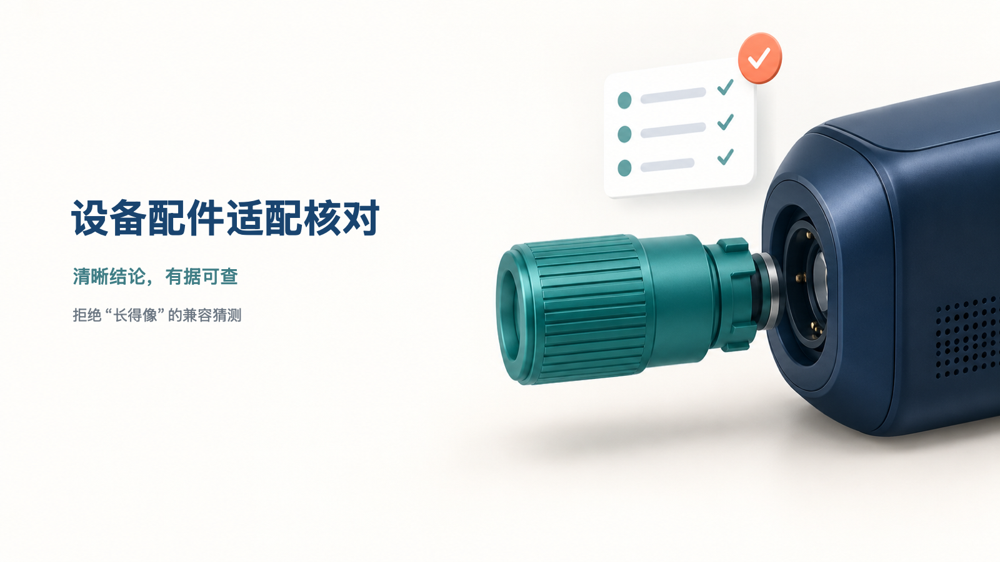

# 设备配件适配核对

用商家确认的设备型号、配件规格和厂家适配/排除表，逐项核对顾客问的组合，输出“确认适配 / 明确不适配 / 未知”和对应依据。无来源依据的规则不能确认；已满足的明确排除优先于通用适配。型号或地区版本、接口协议、系统版本等条件缺失时会明确列待补资料；只写 USB-C 等接口名称仍为未知；不会把“长得像”当作兼容，也不承诺未提供的电气性能。

使用示例：

```bash
node scripts/check-compatibility.mjs fixtures/success-input.json
```

结果是一张设备型号 × 配件规格核对表；没有厂家条目的组合会显示“未知”，不会推测兼容。



## 输入与结果

输入最多 10 种设备、10 个配件，以及厂家明确的适配或排除资料和顾客具体条件。结果是型号—规格逐项对照表，包含状态、引用依据与缺失资料提示。范围仅限明确条件核对：不做实际测试，不承诺电气性能，也不因插头相同推断全功能兼容。

## 安装与运行

```bash
npx skills add xxjrq/shop-device-compatibility-check-cn
node scripts/self-test.mjs
```

- [成功输入](fixtures/success-input.json) → [成功参考交付](fixtures/success-output.json)
- [资料不足输入](fixtures/failure-input.json) → [资料不足参考交付](fixtures/failure-output.json)
- English: [README.en.md](README.en.md)

## 来源与许可

本 Skill 的说明、脚本和示例均为原创。业务用途仅参考 [ERPNext Item 文档定义](https://github.com/frappe/erpnext/blob/develop/erpnext/stock/doctype/item/item.json)，未复制其内容或代码；该上游项目采用 GPL-3.0。此仓库自身采用 [MIT License](LICENSE)。
